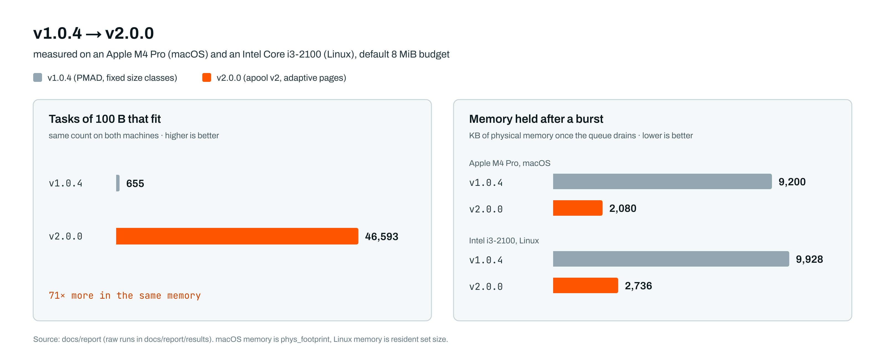

# Changelog

## 2.1.0 (2026-11-10)

- `make MAX_PAYLOAD=N` builds a daemon for payloads above 1,024 bytes (a multiple of 16, up to 16,320). The page record now keeps the size class in 16 bits, since such a build has more than 255 sizes; `make check-big` checks an 8 KiB build against the capacity formula.
- Value-aware admission: `MSG_SUBMIT_VALUED` (0x0D) carries a level 0-15, the queue keeps one FIFO per level and dispatches the highest first, and `[allocator] admission = refuse | oldest | value` (default `value`) decides what happens when the budget is full. A task is evicted only when `apool_free_makes_room` proves its memory fits the new one; its producer gets `FAILED` with the reason `evicted`. Level 15 is never evicted. `test_admission` adds 26 checks.
- `quicx status` shows evicted tasks; the stats header is 81 bytes.
- A disconnecting producer is forgotten: results for its queued and running tasks are no longer sent to a later connection that reuses the descriptor.
- Each port has its own CLI socket and pid file (`/tmp/quicx-<port>.sock`, `.pid`); `status` and `stop` take `--port`.
- Reads and writes that hit `EAGAIN` on a non-blocking socket now wait with `poll()` (up to 1 s) instead of dropping the connection; found when a frame arrived split across two TCP reads.
- Benchmarks: `docs/report/scripts/admission`, `docs/report/scripts/several` (several daemons, pinned per core), `docs/report/scripts/redis`; research in `docs/research/learned-value`.

## 2.0.0

The allocator that manages the budget is new. Up to 1.0.4 it was PMAD, which divided the memory between block sizes by fixed percentages before any task arrived. apool hands out 16 KiB pages to the sizes that actually show up and takes them back when they empty. Also new: QXP as the protocol's name, a strict config parser (`quicx.conf`, file and line on every error), a control pool for connections and workers, stripped release binaries of 32 to 72 KB, and the Java client 2.0.0 on Maven Central.

### 2.0.0 compared with 1.0.4

<picture>
  <source media="(prefers-color-scheme: dark)" srcset="docs/assets/results-dark.png">
  
</picture>

PMAD, the allocator in 1.0.4, split the budget between block sizes by fixed percentages at startup. Whatever share a size didn't use stayed unused, so the number of tasks that fit depended on how well the traffic matched the split. Both versions were measured with the same scripts on the same two machines.

Tasks that fit in 8 MiB (same on both machines):

| Payload | 1.0.4 | 2.0.0 | |
|---|---:|---:|---:|
| 100 B | 655 | 46,593 | 71× |
| 900 B | 180 | 8,016 | 45× |
| 40 B | 1,310 | 73,146 | 56× |
| 300 B | 262 | 22,044 | 84× |
| nginx log lines | 1,433 | 30,947 | 22× |

Physical memory of the daemon in KB. 1.0.4 wrote a header into every block when it started, so it held the whole pool from the first second:

| | 1.0.4, M4 Pro | 2.0.0, M4 Pro | 1.0.4, i3 | 2.0.0, i3 |
|---|---:|---:|---:|---:|
| just started | 9,200 | 1,056 | 9,928 | 1,796 |
| queue full | 9,200 | 9,088 | 9,928 | 9,816 |
| after the queue drains | 9,200 | 2,080 | 9,928 | 2,736 |

Throughput and latency stayed where they were; the differences are smaller than the spread between runs of the same version:

| | 1.0.4, M4 Pro | 2.0.0, M4 Pro | 1.0.4, i3 | 2.0.0, i3 |
|---|---:|---:|---:|---:|
| throughput (tasks/s) | 82,400 | 81,900 | 19,000 | 19,000 |
| latency p50 | 47 µs | 49 µs | 128 µs | 123 µs |
| latency p99 | 111 µs | 98 µs | 162 µs | 198 µs |

PMAD on its own is still the faster allocator (13.3 ns per task on the M4 Pro, against 14.8 ns for apool). A task's round trip through the daemon takes tens of microseconds, so the difference doesn't show up there.

The end-to-end tests found a bug in 1.0.4. A 16-byte task shares a block size with a connection in PMAD, and a 32-byte task shares one with a worker. If the queue fills up with such tasks before any worker has connected, the next worker can't get memory to register, and the queue stays full until the daemon is restarted. 1.0.4 fails 4 of the 27 end-to-end checks because of this, on both machines. 2.0.0 passes all 27, since connections and workers now have a pool of their own.
