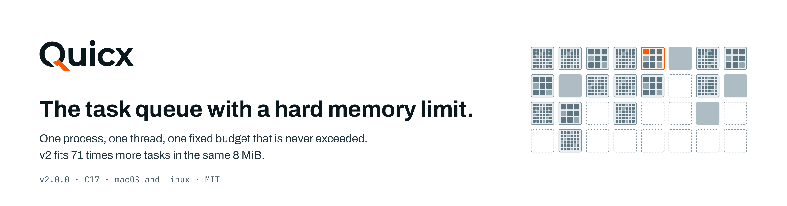
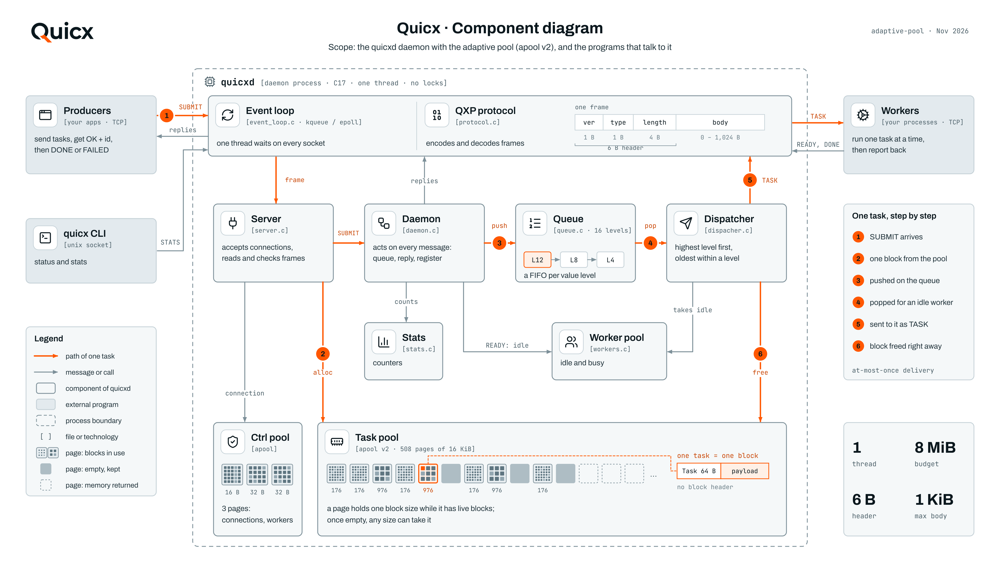
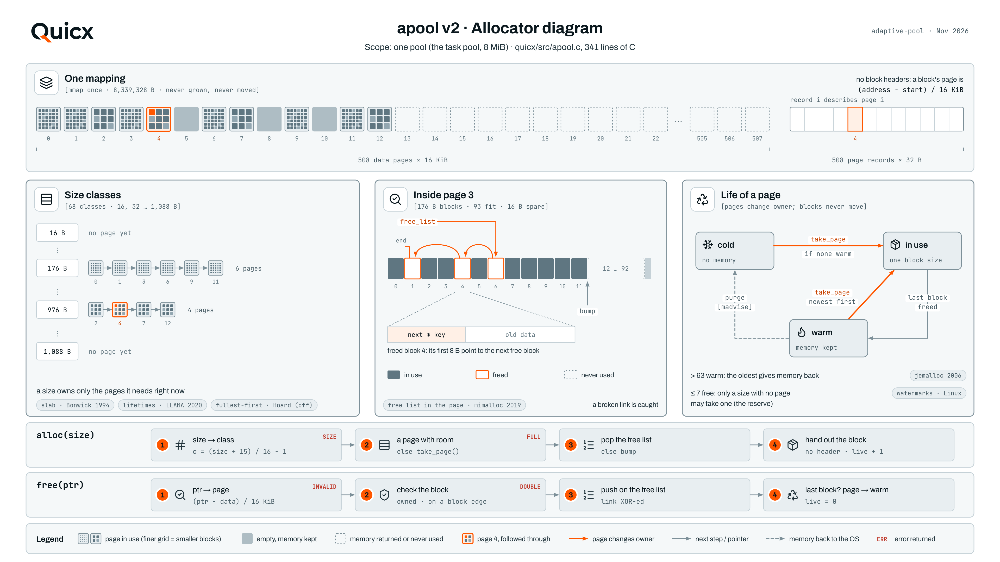

<p align="center">
  <picture>
    <source media="(prefers-color-scheme: dark)" srcset="docs/assets/banner-dark.png">
    
  </picture>
</p>

Quicx is a task queue for devices and servers with little memory. Producers send it tasks over TCP, workers take them one at a time, and the producer hears back when a task is done. It is given one memory budget when it starts and never goes past it. When the budget is full, it keeps the most valuable work: a new task can push out a waiting task of lower value, but only when Quicx's own allocator proves that the freed memory will hold the new task. As far as I could find, no other task queue does this.

Because every task takes a known amount of memory, the capacity of a budget can be worked out before the device leaves the desk. Each daemon is a single thread with nothing shared, so one daemon per core gives isolation and adds throughput: two daemons on two cores did 1.92 times the work of one. The whole program is 32 KB on a Raspberry Pi, with no dependencies.

Website: [quicx.dev](https://quicx.dev). Documentation: [quicx.dev/docs](https://quicx.dev/docs). Every number on this page comes from a script in this repository; [`docs/README.md`](docs/README.md) lists which one.

## Contents

- [What it gives you](#what-it-gives-you)
- [Install and run](#install-and-run)
- [When the budget is full: keep the most valuable work](#when-the-budget-is-full-keep-the-most-valuable-work)
- [Plan capacity before you deploy](#plan-capacity-before-you-deploy)
- [One daemon per core](#one-daemon-per-core)
- [RTOS-style guarantees on a normal OS](#rtos-style-guarantees-on-a-normal-os)
- [How a task moves through the daemon](#how-a-task-moves-through-the-daemon)
- [The allocator](#the-allocator)
- [Measured](#measured)
- [Research: learning what a task is worth](#research-learning-what-a-task-is-worth)
- [Using it from code](#using-it-from-code)
- [Configuration](#configuration)
- [What Quicx does not do](#what-quicx-does-not-do)
- [Building and tests](#building-and-tests)
- [Repository layout](#repository-layout)

## What it gives you

| | Measured |
|---|---|
| The most valuable work survives overload | 100 % of valuable tasks done under overload, against 31.6 % for a queue that refuses new tasks; a valuable task waits 4.1 ms instead of 3.5 s |
| Memory is a hard limit | the queue never takes more than its budget; a full queue answers `ERROR 0x01` and keeps running |
| Capacity is known in advance | the formula below gave exactly the measured count in every test (46,593 tasks of 100 B in 8 MiB) |
| Daemons are isolated and scale by core | 2 daemons on 2 cores: 35,000 tasks/s against 18,200 for one; filling one of ten daemons left the other nine untouched |
| Small and fast | 32 KB on Linux arm64, no dependencies; 81,900 tasks/s and a 49 µs median on an Apple M4 Pro |

## Install and run

```sh
curl -fsSL https://quicx.dev/install.sh | sh
```

The script downloads the `quicx` binary for your OS and CPU and puts it in `/usr/local/bin`. To build from source, see [building and tests](#building-and-tests).

```sh
quicx start                        # port 16381, 8 MiB
quicx start --config quicx.conf    # with a config file
quicx status                       # what the daemon is doing right now
quicx stop
```

`quicx status` with 1,200 tasks of 100 B and 300 of 900 B waiting and no worker connected:

```
  quicx v2.0.0  ·  pid 8278  ·  up 0h 0m 00s

  tasks     submitted       1,500
            completed           0   ░░░░░░░░░░░░░░░░░░░░     0.0%
            failed              0                            0.0%
            in flight       1,500   = 1500 queued + 0 running
            queued          1,500

  workers   busy                0   ░░░░░░░░░░░░░░░░░░░░     0.0%
            idle                0
            total               0   · 0 registered since start

  memory    32 / 508 pages          █░░░░░░░░░░░░░░░░░░░     6.3%
            pool 7.95 MiB, 16 KiB pages · 2 sizes in use

           176B    1,200 /   1,209  ███████████████████░    99.3%    13 pages
           976B      300 /     304  ███████████████████░    98.7%    19 pages
```

## When the budget is full: keep the most valuable work

A queue that is out of memory has to drop something. Most queues refuse the newest task (Redis with `maxmemory`, RabbitMQ with `reject-publish`), and streaming tools drop the oldest (GStreamer's leaky queue, NATS with `discard old`). Neither looks at what the work is worth.

In Quicx a producer can give each task a value level from 0 to 15 with `MSG_SUBMIT_VALUED`. Higher levels are dispatched first. When the budget is full and a task arrives, Quicx looks for a waiting task of a lower level, the oldest of the lowest level first, evicts it, and tells its producer with `MSG_FAILED` and the reason `evicted`. Level 15 is never evicted, so a stop command cannot bounce off a queue full of camera frames. Plain `MSG_SUBMIT` tasks get level 8, so a queue whose clients send no values simply refuses new tasks when full.

What a general-purpose allocator cannot tell a queue is whether freeing a particular task will make room for the new one: the memory may come free in a page the new task cannot use, and the evicted task would be lost for nothing. apool knows. `apool_free_makes_room` allows an eviction only when the victim's block is the same size as the new one, or when it is the last live block of its page and the reserve lets the new size take that page. A task is never thrown away without making room. `test_admission` checks these rules (26 checks).

Measured on the real daemon: a 256 KiB budget (1,752 tasks), one worker at 2 ms per task, median of 3 runs. Steady: 2,000 tasks a second for 15 s, one in ten valuable, chosen at random. Burst: valuable tasks at 1,000 a second for 3 s, then ordinary ones at 2,000 a second for 9 s. All four rules ran on the same daemon (`admission = refuse | oldest | value`), so only the rule differs.

| When the budget is full | steady: valuable tasks done | steady: wait of a valuable task | steady: tasks evicted | burst: valuable tasks done |
|---|---:|---:|---:|---:|
| refuse the new task, no values | 31.6 % | 3,506 ms | 0 | 100 % |
| order by value, refuse the new task | 31.2 % | 4.1 ms | 0 | 100 % |
| evict the oldest | 100 % | 4.1 ms | 20,749 | 64.6 % |
| **Quicx: evict by value, only with proven room** | **100 %** | **4.1 ms** | **2,056** | **100 %** |

Ordering by value alone shortens the wait but cannot save valuable tasks that arrive while the budget is full. Evicting the oldest saves them in the steady run but evicts ten times as much work, and in the burst the flood of ordinary tasks pushes out 1,062 valuable ones. Only evicting by value keeps every valuable task in both runs. Every rule completes the same number of tasks (about 9,250 and 7,750), so the choice costs no throughput. [Script](docs/report/scripts/admission/bench_admission.py), [raw results](docs/report/results/admission).

### What else does this

I checked the queues and brokers that are used most and the systems in the literature that drop data under overload. Each has some of the parts; none has all four.

| | task queue with workers | exact memory limit | keeps the valuable work when full | evicts only with proven room |
|---|:---:|:---:|:---:|:---:|
| Redis, with Celery or BullMQ | yes | partly ¹ | no | no |
| RabbitMQ | yes | partly ² | no | no |
| NATS JetStream | yes | partly ³ | no | no |
| beanstalkd | yes | no | no | no |
| Mosquitto (MQTT) | no | yes | no | no |
| Eclipse iceoryx | no | yes | no | no |
| GStreamer `queue` | no | partly ³ | no | no |
| network switches with push-out [[14]](#ref-14) | no | yes | yes | not needed ⁴ |
| Aurora load shedding [[12]](#ref-12) | no | no | yes | no |
| **Quicx** | **yes** | **yes** | **yes** | **yes** |

1. `maxmemory` counts Redis's data, not the process: set to 56 MiB, Redis peaked at 63.7 MiB in a 64 MB container.
2. RabbitMQ blocks publishers when the whole process passes a share of RAM; `x-max-length-bytes` counts message bodies only.
3. The limit counts message bytes, not the memory they take.
4. Cells have one size, so pushing one out always frees exactly enough.

Keeping the more important data is an old idea: switches push lower-priority cells out of a full buffer, Aurora sheds the least useful tuples, and web caches evict by value per byte (GreedyDual-Size [[13]](#ref-13)). There, every item has one size or only bytes are counted, so freeing always makes room. In a queue of tasks of different sizes it does not, and Quicx asks its allocator before it evicts.

## Plan capacity before you deploy

A task is a 64-byte record plus its payload, rounded up to 16 bytes. A 16 KiB page holds as many blocks as fit whole. Three pages hold connections and workers, and 1/64 of the task pages are kept for a size that has none yet:

```
block      = ceil((64 + payload) / 16) * 16
per page   = floor(16384 / block)
task pages = pool / 16 KiB - 3 - (one page of records per 512)
tasks      = (task pages - task pages / 64) * per page
```

| pool_size | payload | calculated | measured |
|---|---|---:|---:|
| 8 MiB | 100 B | 46,593 | 46,593 |
| 8 MiB | 40 B | 73,146 | 73,146 |
| 256 KiB | 48 B | 1,752 | 1,752 |

An example: a camera makes 30 frames a second and the model analyses 10, so 20 more frames wait every second. Each task carries the frame's number and path (48 bytes), a 112-byte block. With `pool_size = 208K` Quicx holds exactly 1,314 waiting frames in 208 KB of queue memory. The queue is full after about 65 seconds; from then on more valuable frames displace less valuable ones, and the device keeps running.

## One daemon per core

Each daemon is a separate process with its own port, budget, CLI socket and pid file. Daemons share nothing, so they never wait for each other: a critical stream can have a daemon of its own that a flood elsewhere cannot reach, and work can be spread across several the way a load balancer spreads requests.

```sh
quicx start --port 16401 --config camera.conf
quicx start --port 16402 --config commands.conf
quicx status --port 16401
quicx stop --port 16402
```

On Linux, pin each daemon to its own core with `taskset -c N`. On an Intel i3-2100 (two cores), with every producer and worker held on the other two hardware threads in both runs, median of 3:

| daemons, each pinned to its own core | per daemon | total | CPU per daemon |
|---:|---:|---:|---:|
| 1 | 18,200 tasks/s | 18,200 tasks/s | 97 % |
| 2 | 17,500 tasks/s | 35,000 tasks/s | 96-97 % |

Two daemons do 1.92 times the work of one. The core has to be theirs: with nothing pinned and the test's clients on the same cores, the second daemon adds 29 %. On an Apple M4 Pro, where the test's clients run on the same cores, the total stays at the machine's limit but splits evenly: six daemons got 10,000 tasks/s each, within 5 % of one another. With ten daemons of 8 MiB on one machine, filling one to its limit left the other nine accepting tasks as before; an idle daemon takes about 1.4 MiB. [Scripts](docs/report/scripts/several), [Linux results](docs/report/results/several/linux-i3.md), [Mac results](docs/report/results/several/summary.md).

The default port keeps `/tmp/quicx.sock` and `/tmp/quicx.pid`; any other port uses `/tmp/quicx-<port>.sock` and `/tmp/quicx-<port>.pid`.

## RTOS-style guarantees on a normal OS

Robots, cameras and other devices with a model on board need a task queue between the parts that make work and the parts that do it. On microcontrollers that job falls to a real-time OS such as FreeRTOS or Zephyr. The cameras and the AI usually run on Linux, where a queue grows until memory runs out.

| | RTOS (FreeRTOS, Zephyr) | Linux with a plain queue | Linux with Quicx |
|---|---|---|---|
| queue memory known in advance | yes | no | yes |
| critical work goes first | yes, task priorities | only with a priority queue | yes, levels 0-15 |
| when the queue is full | the sender waits or gets an error | it grows until memory runs out | less valuable work makes room; level 15 is never refused |
| constant-time memory per task | yes, block pools | not always | yes, apool |
| drivers, networking, AI frameworks | few | all | all |
| guaranteed deadlines | yes | no | no |

Quicx does not make Linux a real-time OS: it promises nothing about how many microseconds a task takes. Where hard deadlines matter, such as motor control, an RTOS stays the right tool, and Quicx can run beside it on the board that does the thinking. apool works inside one block of memory and does not depend on the OS, so porting it and the eviction rule to an RTOS is a next step.

## How a task moves through the daemon

<picture>
  <source media="(prefers-color-scheme: dark)" srcset="docs/report/figures/quicx-architecture-dark.png">
  
</picture>

The orange path in the diagram, in order:

1. A producer sends SUBMIT (or SUBMIT_VALUED with a level) with a task type and up to 1,024 bytes of payload.
2. The server takes one block from the task pool (a 64-byte record with room for the payload behind it) and reads the payload straight into it. If there is no room, admission tries to evict a lower-level task with proven room; if it can't, the producer gets `ERROR 0x01` and its connection keeps working.
3. The daemon appends the task to the queue of its level and replies OK with the task's id.
4. As soon as a worker has sent READY, the dispatcher takes the oldest task of the highest level.
5. The task goes to that worker as TASK.
6. Its block is freed right away, which is why delivery is at-most-once. When the worker answers DONE or FAILED, the daemon passes the answer on to the producer.

Connections and workers live in a separate control pool of 3 pages. A queue full of tasks can't touch that memory, so a worker can always connect and start draining it.

The source is about 2,800 lines in `quicx/src`:

- `event_loop.c` waits on every socket with kqueue or epoll, in one thread
- `protocol.c` reads and writes QXP frames
- `server.c` accepts connections, checks frames and allocates each task's block
- `admission.c` decides which waiting task, if any, makes room when the budget is full
- `daemon.c` handles each message: queue a task, register a worker, forward a result
- `queue.c`, `dispacher.c` and `workers.c` hold the queue (one FIFO per level), hand tasks to idle workers and track who is idle or busy
- `apool.c` is the allocator, and `config.c` with `pool_config.c` read `quicx.conf`
- `stats.c` and `cli.c` are the counters behind `quicx status` and the command line itself

## The allocator

<picture>
  <source media="(prefers-color-scheme: dark)" srcset="docs/report/figures/apool-architecture-dark.png">
  
</picture>

apool maps the whole budget once: 508 pages of 16 KiB, followed by a 32-byte record for each page. A page in use holds blocks of one size, out of 68 sizes from 16 to 1,088 bytes. Blocks have no header. The allocator finds a block's page by dividing its offset by 16 KiB, and the page's record says the rest: which size it serves, how many blocks are live, where its free list starts. Freed blocks are chained through their own first bytes, so allocating and freeing take the same time however full the pool is. When the last block on a page is freed, the page goes back to a shared list, and whichever size needs a page next takes it. That is also what lets the allocator prove that an eviction makes room.

Each technique comes from an earlier allocator. I put every one behind its own switch so its effect could be measured separately, and kept the ones that helped:

| Technique | Taken from | Effect | Cost |
|---|---|---|---|
| Pages change size class | slab allocator [[1]](#ref-1), mimalloc [[3]](#ref-3), memcached [[8]](#ref-8) | 46,593 tasks of 100 B fit in 8 MiB | none measured |
| Reserve | Linux zone watermarks [[6]](#ref-6), memcached [[8]](#ref-8) | after a flood of one size, a new size still gets a page (16 tasks of 900 B instead of 0) | 1.4 % less capacity at 100 B |
| Hardening | mimalloc's secure mode [[3]](#ref-3) | a double free or an overwritten free-list link is detected | 1 ns per task on the M4 Pro, 13 ns on the i3 |
| Purge with a warm list | jemalloc [[4]](#ref-4), mimalloc [[3]](#ref-3), `madvise` [[9]](#ref-9), [[10]](#ref-10) | 1,104 KB held after a drain instead of 8,096 KB | 102 ns per block instead of 8.7 when the whole pool fills and empties again and again |
| One block per task | new in Quicx | about 10 ns less per task on the M4 Pro, 48 ns on the i3 | none |
| Control pool | reserved pools in Linux (`mempool`) [[7]](#ref-7) | workers can register even when the task pool is full | 3 pages of the budget |

Two more were tried and aren't used. Taking blocks from the fullest page first (Hoard [[2]](#ref-2)) made no difference for queue traffic and cost about 5 ns per task. Giving long-lived blocks pages of their own (LLAMA [[5]](#ref-5)) only helps if the caller says which tasks will live long, and the daemon doesn't do that yet. The 16 KiB page size was measured too: 4 KiB pages made each operation slower (22.2 against 14.9 ns per task), and 64 KiB pages held fewer tasks in a mixed queue (23,680 against 29,952).

## Measured

Default settings, `-O2`, on an Apple M4 Pro (macOS 26.5, Apple clang 17) and an Intel Core i3-2100 from 2011 with 2 cores and 4 threads (Ubuntu 24.04, gcc 13.3). The clients are written in C and run on the same machine, over loopback TCP. Median of 5 runs:

| | M4 Pro | i3-2100 |
|---|---:|---:|
| throughput (tasks/s) | 81,900 | 19,000 |
| latency p50 | 49 µs | 123 µs |
| latency p90 | 64 µs | 157 µs |
| latency p99 | 98 µs | 198 µs |
| latency p99.9 | 143 µs | 208 µs |

Throughput is a closed loop: 8 workers and 2 producers, each producer with 4 connections and 32 tasks in flight per connection, 10 seconds, no errors. Latency is from submit until the task is done, in an open loop at a fixed rate (40,000 tasks/s on the Mac, 9,000 on the i3), counted from the moment each task was due to be sent, so a stall shows up.

Tasks that fit in the default 8 MiB, the same on both machines:

| Payload | Tasks |
|---|---:|
| 40 B | 73,146 |
| 100 B | 46,593 |
| nginx log lines (188 B on average) | 30,947 |
| 300 B | 22,044 |
| 900 B | 8,016 |

Physical memory of the whole process during one burst, in KB, median of 3 (macOS `phys_footprint`, Linux RSS):

| | M4 Pro | i3-2100 |
|---|---:|---:|
| just started | 1,056 | 1,796 |
| queue full | 9,088 | 9,816 |
| after the queue drains | 2,080 | 2,736 |

In a 64 MB Docker container flooded with 40,000 tasks a second, Quicx with its default 8 MiB answered `ERROR 0x01` once full and never went past 11.7 MiB; Redis with its defaults has no limit and was killed by the kernel at 14.7 s with its whole queue. With the same limit Redis holds more tasks (a 100-byte item costs it about 103 bytes, a Quicx task 176), but its limit counts data only and the process went past it ([details](docs/report/scripts/redis/README.md)).

Tests: 155 unit checks (`test_apool` 50, `test_config` 45, `test_wire` 34, `test_admission` 26) and 27 end-to-end checks against the running daemon, on macOS arm64 and Linux x86-64. Real runs found bugs the unit tests did not, and all are fixed: a frame split across two TCP reads closed the connection (now covered by `test_wire`); a queue filled with 16-byte tasks before any worker connected left no memory for workers to register (covered by the end-to-end checks); two daemons on one machine shared one CLI socket. Reading the code found a fourth: results for a producer that had disconnected could reach the next connection that reused its descriptor.

## Research: learning what a task is worth

A camera often can't tell which frame is valuable until the model has looked at it. Workers do know, after the fact. [`docs/research/learned-value`](docs/research/learned-value) simulates Quicx's admission rule with ten ways of learning a task's level from the scores workers return, on four workloads.

On a field robot (two cameras at 15 frames/s, a model that analyses 8, disease in patches of about 3 s), logistic regression on the sender's recent scores and the frame's size, plus one probe frame per camera every 0.5 s, analysed 66.7 % of the diseased frames against 27.7 % for a queue without values, and found sick patches after 0.47 s instead of 16.2 s. Learning without exploration did worse than not learning, reinforcement learning of the level itself reached 51.6 %, and where nothing predicts value no strategy helps. The next step is `admission = learned` in the daemon, with a score byte in DONE.

## Using it from code

With the Java client, `dev.quicx:quicx-client` (Maven Central):

```java
// producer
try (QuicxClient client = new QuicxClient("localhost", 16381)) {
    int taskId = client.submit("send_email", "{\"to\":\"user@example.com\"}");
}

// worker
new QuicxWorker("localhost", 16381)
    .handle("send_email", payload -> { /* do the work */ })
    .start();
```

The Java client sends plain SUBMIT; value levels need QXP directly for now. Each QXP message is a 6-byte header (version 1, type, body length as a big-endian u32) and a body. A valued task from Python:

```python
import socket, struct

def frame(msg_type, body):
    return struct.pack(">BBI", 1, msg_type, len(body)) + body

s = socket.create_connection(("localhost", 16381))
f = s.makefile("rb")
kind, payload, level = b"frame", b"/cam/0/000123.jpg", 12
s.sendall(frame(0x0D, bytes([level, len(kind)]) + kind + payload))   # SUBMIT_VALUED
version, msg_type, length = struct.unpack(">BBI", f.read(6))
body = f.read(length)
if msg_type == 0x02:
    print("accepted, task", struct.unpack(">I", body[:4])[0])          # OK
```

| Message | Sent by | |
|---|---|---|
| `SUBMIT` 0x01 | producer | a new task: type length, type, payload |
| `SUBMIT_VALUED` 0x0D | producer | the same with a level byte first (0-15) |
| `OK` 0x02 | daemon | accepted, with the task id |
| `ERROR` 0x03 | daemon | refused: 0x01 queue full, 0x02 invalid message, 0x03 payload too big, 0x04 unknown type, 0x05 wrong version |
| `READY` 0x04 | worker | ready for a task |
| `TASK` 0x07 | daemon | a task for that worker |
| `DONE` 0x05, `FAILED` 0x06 | worker, daemon | the result, forwarded to the producer; FAILED `evicted` when admission made room |
| `HEARTBEAT` 0x09, `PONG` 0x0A | client, daemon | keep-alive |
| `STATS` 0x0B, 0x0C | CLI | statistics, over a unix socket |

The layout of every body is in the [QXP documentation](https://quicx.dev/docs/binary-protocol).

## Configuration

Every key is optional. This is the default configuration, and it is what [`quicx.conf`](quicx.conf) contains:

```ini
[server]
port = 16381

[memory]
pool_size = 8M          # the whole budget (K, M or G)

[allocator]
admission     = value   # when full: refuse, oldest or value
reserve       = on      # keep the last free pages for sizes that have none
hardening     = on      # encoded free lists, double frees caught
purge         = on      # give the memory of empty pages back after a burst
fullest_first = off     # no gain on queue traffic
warm_pages    = auto    # empty pages kept before purging (1/8 of the pages)
reserve_pages = auto    # pages held back by the reserve (1/64 of the pages)
```

A misspelled key or a value that can't be used stops Quicx before it starts, with the file and line, for example `quicx.conf:14: purge must be on or off, not 'sometimes'`. `--port` on the command line overrides the file.

## What Quicx does not do

- Nothing is persisted. A restart empties the queue.
- There is no redelivery. A task is freed as it is sent, so if the worker dies, the task is gone.
- No retries or delayed tasks.
- Payloads over 1,024 bytes are refused with `ERROR 0x03`; send a path or an id and keep large data elsewhere.
- One daemon uses one core. For more, run one daemon per core.
- No real-time deadlines.

If losing a task when a worker crashes is not acceptable for you, use a broker with at-least-once delivery, such as beanstalkd or Redis Streams.

## Building and tests

A C17 compiler and `make` are enough.

```sh
make            # the daemon and the unit tests
make test       # test_apool (50 checks), test_config (45), test_wire (34), test_admission (26)
make e2e        # 27 end-to-end checks against ./quicxd, needs python3
make bench      # bench_apool and bench_purge
```

## Repository layout

```
quicx/include, quicx/src     the daemon
quicx/src/tests              unit tests and allocator benchmarks
pmad/                        the allocator of 1.x, the baseline for bench_apool
docs/README.md               where every number comes from
docs/report/                 the technical report: LaTeX, scripts, raw results, diagrams
docs/report/scripts/         benchmarks: bench (C load generator), admission, several, redis
docs/report/results/         raw output of every run
docs/research/learned-value/ simulation of learned task values
docs/assets/                 images used in this README
quicx.conf                   every setting, with its default value
CHANGELOG.md                 what changed between releases
```

## References

1. <a id="ref-1"></a>Jeff Bonwick. "The Slab Allocator: An Object-Caching Kernel Memory Allocator." USENIX Summer 1994 Technical Conference, Boston. [usenix.org](https://www.usenix.org/legacy/publications/library/proceedings/bos94/bonwick.html). Used for: pages that hold blocks of one size.
2. <a id="ref-2"></a>Emery D. Berger, Kathryn S. McKinley, Robert D. Blumofe and Paul R. Wilson. "Hoard: A Scalable Memory Allocator for Multithreaded Applications." ASPLOS-IX, 2000, pp. 117–128. [doi:10.1145/378993.379232](https://doi.org/10.1145/378993.379232). Tried: fullest page first.
3. <a id="ref-3"></a>Daan Leijen, Benjamin Zorn and Leonardo de Moura. "Mimalloc: Free List Sharding in Action." APLAS 2019, LNCS 11893, Springer. [doi:10.1007/978-3-030-34175-6_13](https://doi.org/10.1007/978-3-030-34175-6_13). Used for: a free list per page, encoded links, returning memory.
4. <a id="ref-4"></a>Jason Evans. "A Scalable Concurrent malloc(3) Implementation for FreeBSD." BSDCan 2006. [PDF](https://people.freebsd.org/~jasone/jemalloc/bsdcan2006/jemalloc.pdf). Used for: purging unused pages.
5. <a id="ref-5"></a>Martin Maas, David G. Andersen, Michael Isard, Mohammad Mahdi Javanmard, Kathryn S. McKinley and Colin Raffel. "Learning-based Memory Allocation for C++ Server Workloads." ASPLOS 2020, pp. 541–556. [doi:10.1145/3373376.3378525](https://doi.org/10.1145/3373376.3378525). Tried: pages by lifetime.
6. <a id="ref-6"></a>Mel Gorman. *Understanding the Linux Virtual Memory Manager.* Prentice Hall, 2004, chapter 2. Used for: keeping the last free pages in reserve.
7. <a id="ref-7"></a>Jonathan Corbet, Alessandro Rubini and Greg Kroah-Hartman. *Linux Device Drivers*, 3rd edition. O'Reilly, 2005, chapter 8. Used for: a memory pool set aside so work can continue.
8. <a id="ref-8"></a>memcached. "Release Notes for v1.4.11" (slab_reassign and slab_automove), 2012. [github.com/memcached](https://github.com/memcached/memcached/wiki/ReleaseNotes1411). Used for: moving pages between size classes.
9. <a id="ref-9"></a>Linux man-pages. madvise(2). [man7.org](https://man7.org/linux/man-pages/man2/madvise.2.html). `MADV_DONTNEED`.
10. <a id="ref-10"></a>Apple. XNU source, `bsd/sys/mman.h`. [github.com/apple-oss-distributions](https://github.com/apple-oss-distributions/xnu/blob/main/bsd/sys/mman.h). `MADV_FREE_REUSABLE`.
11. <a id="ref-11"></a>Simon Brown. The C4 model, notation and diagram review checklist. [c4model.com](https://c4model.com/diagrams/checklist). The rules the diagrams follow.
12. <a id="ref-12"></a>Nesime Tatbul, Uğur Çetintemel, Stan Zdonik, Mitch Cherniack and Michael Stonebraker. "Load Shedding in a Data Stream Manager." VLDB 2003. Prior art: dropping the least useful data under overload.
13. <a id="ref-13"></a>Pei Cao and Sandy Irani. "Cost-Aware WWW Proxy Caching Algorithms." USENIX Symposium on Internet Technologies and Systems, 1997. Prior art: GreedyDual-Size, eviction by value per byte.
14. <a id="ref-14"></a>US patent 5,721,833, "Push-out of low priority signals from switch buffers." Prior art: lower-priority cells pushed out of a full switch buffer.

## Licence

MIT, see [LICENSE](LICENSE). The diagrams use icons from [Lucide](https://lucide.dev) (ISC) and the fonts Archivo and JetBrains Mono (SIL Open Font License).
