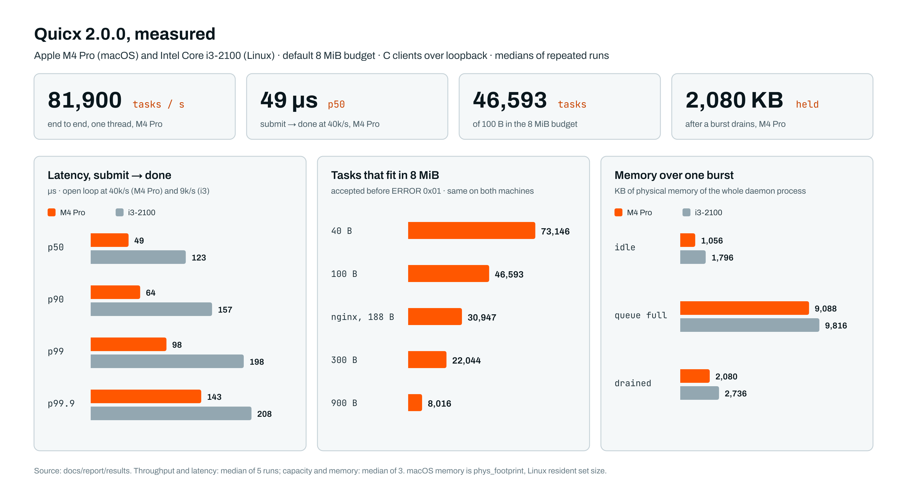
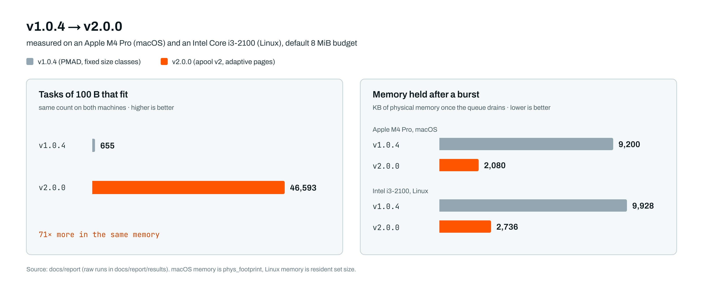

<p align="center">
  <picture>
    <source media="(prefers-color-scheme: dark)" srcset="docs/assets/banner-dark.png">
    
  </picture>
</p>

Quicx is a task queue daemon written in C. Producers send it tasks over TCP, workers take them one at a time, and each producer hears back when its task is done. The daemon is a single process with a single thread, and it never uses more memory than the budget it was started with (8 MiB unless you change it). Once that budget is full, a new task gets an error and the process stays the same size.

Version 2.0 replaces the allocator that manages the budget. Up to 1.0.4 it was PMAD, which divided the memory between block sizes by fixed percentages before any task arrived. The new allocator, apool, hands out 16 KiB pages to the sizes that actually show up and takes them back when they empty. In the default 8 MiB there is now room for 46,593 tasks of 100 bytes, where 1.0.4 had room for 655, and the memory a burst used goes back to the operating system once the queue drains.

Website: [quicx.dev](https://quicx.dev). Documentation: [quicx.dev/docs](https://quicx.dev/docs). Every number below comes from the [report in `docs/report`](docs/report/main.pdf), which also has the raw output of each run.

## Why a fixed budget

A queue that grows with its backlog is fine on a machine of its own. Put it next to the application it serves, on a small VM or in a container with a memory limit, and the two end up fighting over the same memory. Quicx works the other way around. You decide up front how much memory the queue may have, and it stays inside that number even if producers outrun the workers for hours.

The rest of the design follows from keeping it small. The binary is 55 KB of C17 with no dependencies and runs on macOS (kqueue) and Linux (epoll), on x86-64 and arm64. Clients talk to it with a binary protocol of 12 message types behind a 6-byte header, and there is a Java client. Delivery is at-most-once and nothing is written to disk; see [what Quicx does not do](#what-quicx-does-not-do).

## How a task moves through the daemon

<picture>
  <source media="(prefers-color-scheme: dark)" srcset="docs/report/figures/quicx-architecture-dark.png">
  
</picture>

The orange path in the diagram, in order:

1. A producer sends SUBMIT with a task type and up to 1,024 bytes of payload.
2. The server takes one block from the task pool (a 64-byte record with room for the payload behind it) and reads the payload straight into it. If there is no room, the producer gets `ERROR 0x01` and its connection keeps working.
3. The daemon appends the task to the queue and replies OK with the task's id.
4. As soon as a worker has sent READY, the dispatcher takes the oldest task.
5. The task goes to that worker as TASK.
6. Its block is freed right away, which is why delivery is at-most-once. When the worker answers DONE or FAILED, the daemon passes the answer on to the producer.

Connections and workers live in a separate control pool of 3 pages. A queue full of tasks can't touch that memory, so a worker can always connect and start draining it.

The source is about 2,800 lines in `quicx/src`:

- `event_loop.c` waits on every socket with kqueue or epoll, in one thread
- `protocol.c` reads and writes frames
- `server.c` accepts connections, checks frames and allocates each task's block
- `daemon.c` handles each message: queue a task, register a worker, forward a result
- `queue.c`, `dispacher.c` and `workers.c` hold the FIFO, hand tasks to idle workers and track who is idle or busy
- `apool.c` is the allocator, and `config.c` with `pool_config.c` read `quicx.conf`
- `stats.c` and `cli.c` are the counters behind `quicx status` and the command line itself

## The allocator

<picture>
  <source media="(prefers-color-scheme: dark)" srcset="docs/report/figures/apool-architecture-dark.png">
  
</picture>

apool maps the whole budget once: 508 pages of 16 KiB, followed by a 32-byte record for each page. A page in use holds blocks of one size, out of 68 sizes from 16 to 1,088 bytes. Blocks have no header. The allocator finds a block's page by dividing its offset by 16 KiB, and the page's record says the rest: which size it serves, how many blocks are live, where its free list starts and how much of it has been used. Freed blocks are chained through their own first bytes, so allocating and freeing take the same time however full the pool is. When the last block on a page is freed, the page goes back to a shared list, and any size can take it next. That is how the budget follows the traffic.

None of the techniques are new on their own; each one comes from an earlier allocator. I put every one behind its own switch so its effect could be measured separately, and kept the ones that helped:

| Technique | Taken from | Effect | Cost |
|---|---|---|---|
| Pages change size class | slab allocator [[1]](#ref-1), mimalloc [[3]](#ref-3), memcached [[8]](#ref-8) | 46,593 tasks of 100 B fit in 8 MiB | none measured |
| Reserve | Linux zone watermarks [[6]](#ref-6), memcached [[8]](#ref-8) | after a flood of one size, a new size still gets a page (16 tasks of 900 B instead of 0) | 1.4% less capacity at 100 B |
| Hardening | mimalloc's secure mode [[3]](#ref-3) | a double free or an overwritten free-list link is detected | 1 ns per task on the M4 Pro, 13 ns on the i3 |
| Purge with a warm list | jemalloc [[4]](#ref-4), mimalloc [[3]](#ref-3), `madvise` [[9]](#ref-9), [[10]](#ref-10) | 1,104 KB held after a drain instead of 8,096 KB | 102 ns per block instead of 8.7 when the whole pool fills and empties again and again |
| One block per task | new in Quicx | about 10 ns less per task on the M4 Pro, 48 ns on the i3 | none |
| Control pool | reserved pools in Linux (`mempool`) [[7]](#ref-7) | workers can register even when the task pool is full | 3 pages of the budget |

Two more were tried and aren't used. Taking blocks from the fullest page first (Hoard [[2]](#ref-2)) made no difference for queue traffic and cost about 5 ns per task. Giving long-lived blocks pages of their own (LLAMA [[5]](#ref-5)) only helps if the caller says which tasks will live long, and the daemon doesn't do that yet. All of these switches are in [`quicx.conf`](#configuration).

## Benchmarks

<picture>
  <source media="(prefers-color-scheme: dark)" srcset="docs/assets/benchmarks-dark.png">
  
</picture>

This is Quicx 2.0.0 with its default settings, built with `-O2`, on two machines: an Apple M4 Pro on macOS 26.5 (Apple clang 17), and an Intel Core i3-2100 from 2011, with 2 cores and 4 threads, on Ubuntu 24.04 (gcc 13.3). The clients are written in C and run on the same machine as the daemon, over loopback TCP.

Throughput and latency, median of 5 runs:

| | M4 Pro | i3-2100 |
|---|---:|---:|
| throughput (tasks/s) | 81,900 | 19,000 |
| latency p50 | 49 µs | 123 µs |
| latency p90 | 64 µs | 157 µs |
| latency p99 | 98 µs | 198 µs |
| latency p99.9 | 143 µs | 208 µs |

Throughput is a closed loop: 8 workers and 2 producers, each producer with 4 connections and 32 tasks in flight per connection, running for 10 seconds with no errors. Latency is the time from submit until the task is done. It is measured in an open loop at a fixed rate (40,000 tasks/s on the Mac, 9,000 on the i3), from the moment each task was scheduled to be sent, so a stall shows up in the result. On the i3, eleven processes share four hardware threads, and that is what limits it.

How many tasks fit in the default 8 MiB before the daemon answers "queue full". The sizes were sent to the same daemon one after another, with the queue drained in between, and the counts were identical on both machines:

| Payload | Tasks |
|---|---:|
| 40 B | 73,146 |
| 100 B | 46,593 |
| nginx log lines (188 B on average) | 30,947 |
| 300 B | 22,044 |
| 900 B | 8,016 |

Physical memory of the whole daemon process during one burst, in KB, median of 3 runs. macOS reports `phys_footprint` and Linux the resident set size, so compare within a column:

| | M4 Pro | i3-2100 |
|---|---:|---:|
| just started | 1,056 | 1,796 |
| queue full | 9,088 | 9,816 |
| after the queue drains | 2,080 | 2,736 |

During the throughput runs the pool never had more than 14 of its 508 pages in use (2.8%), sampled ten times a second. The binary is 54.9 KB, built with `-O2` and not stripped. The allocator on its own takes 14.8 ns per task (one alloc and one free) on the M4 Pro and 72.8 ns on the i3.

The raw output of every run is in [`docs/report/results`](docs/report/results), and `docs/report/scripts/run_all.sh` produces it again.

## Install and run

```sh
curl -fsSL https://quicx.dev/install.sh | sh
```

The script downloads the `quicx` binary for your OS and CPU and puts it in `/usr/local/bin`. To build it from source instead, see [building and tests](#building-and-tests).

```sh
quicx start                        # port 16381, 8 MiB
quicx start --config quicx.conf    # with a config file
quicx status                       # what the daemon is doing right now
quicx stop
```

This is `quicx status` with 1,200 tasks of 100 B and 300 of 900 B waiting and no worker connected:

```
  quicx v2.0.0  ·  pid 8278  ·  up 0h 0m 00s

  tasks     submitted       1,500
            completed           0   ░░░░░░░░░░░░░░░░░░░░     0.0%
            failed              0                            0.0%
            in flight       1,500   = 1500 queued + 0 running
            queued          1,500

  workers   busy                0   ░░░░░░░░░░░░░░░░░░░░     0.0%
            idle                0
            total               0   · 0 registered since start

  memory    32 / 508 pages          █░░░░░░░░░░░░░░░░░░░     6.3%
            pool 7.95 MiB, 16 KiB pages · 2 sizes in use

           176B    1,200 /   1,209  ███████████████████░    99.3%    13 pages
           976B      300 /     304  ███████████████████░    98.7%    19 pages
```

### From your code

With the Java client, `dev.quicx:quicx-client`:

```java
// producer
try (QuicxClient client = new QuicxClient("localhost", 16381)) {
    int taskId = client.submit("send_email", "{\"to\":\"user@example.com\"}");
}

// worker
new QuicxWorker("localhost", 16381)
    .handle("send_email", payload -> { /* do the work */ })
    .start();
```

From other languages, speak the protocol directly. Each message is a 6-byte header (version, type, length of the body) followed by the body, and a payload can be at most 1,024 bytes:

| Message | Sent by | |
|---|---|---|
| `SUBMIT` 0x01 | producer | a new task with its type and payload |
| `OK` 0x02 | daemon | accepted, with the task id |
| `ERROR` 0x03 | daemon | refused: 0x01 queue full, 0x02 invalid message, 0x03 payload too big, 0x04 unknown type, 0x05 wrong version |
| `READY` 0x04 | worker | ready for a task |
| `TASK` 0x07 | daemon | a task for that worker |
| `DONE` 0x05, `FAILED` 0x06 | worker | the result, forwarded to the producer |
| `HEARTBEAT` 0x09, `PONG` 0x0A | client, daemon | keep-alive |
| `STATS` 0x0B, 0x0C | CLI | statistics, over a unix socket |

The layout of every body is in the [protocol documentation](https://quicx.dev/docs/binary-protocol).

### Configuration

Every key is optional. This is the default configuration, and it is also what [`quicx.conf`](quicx.conf) in this repository contains:

```ini
[server]
port = 16381

[memory]
pool_size = 8M          # the whole budget (K, M or G)

[allocator]
reserve       = on      # keep the last free pages for sizes that have none
hardening     = on      # encoded free lists, double frees caught
purge         = on      # give the memory of empty pages back after a burst
fullest_first = off     # no gain on queue traffic
warm_pages    = auto    # empty pages kept before purging (1/8 of the pages)
reserve_pages = auto    # pages held back by the reserve (1/64 of the pages)
```

A misspelled key or a value that can't be used stops Quicx before it starts, with the file and line, for example `quicx.conf:14: purge must be on or off, not 'sometimes'`. `--port` on the command line overrides the file. Config files from 1.x still load; their `class` lines are ignored.

## What Quicx does not do

- Nothing is persisted. A restart empties the queue.
- There is no redelivery. A task is freed as it is sent, so if the worker dies, the task is gone.
- No retries, priorities or delayed tasks, and only one queue (a FIFO).
- Payloads over 1,024 bytes are refused with `ERROR 0x03`.
- It uses one core. To scale out, run several daemons behind a TCP load balancer.

If losing a task when a worker crashes is not acceptable for you, use a broker with at-least-once delivery, such as beanstalkd or Redis Streams.

## Building and tests

A C17 compiler and `make` are enough.

```sh
make            # the daemon and the unit tests
make test       # test_apool (50 checks), test_config (40), test_wire (28)
make e2e        # 27 end-to-end checks against ./quicxd, needs python3
make bench      # bench_apool and bench_purge
```

[`docs/report`](docs/report/README.md) explains how to run the whole benchmark suite and rebuild the report.

## Repository layout

```
quicx/include, quicx/src   the daemon
quicx/src/tests            unit tests and allocator benchmarks
pmad/                      PMAD, the allocator of 1.x, kept for the comparison below
docs/report/               the report: LaTeX source, raw results, scripts, diagrams
docs/assets/               images used in this README
quicx.conf                 every setting, with its default value
```

## 2.0 compared with 1.0.4

<picture>
  <source media="(prefers-color-scheme: dark)" srcset="docs/assets/results-dark.png">
  
</picture>

PMAD, the allocator in 1.0.4, split the budget between block sizes by fixed percentages at startup. Whatever share a size didn't use stayed unused, so the number of tasks that fit depended on how well the traffic matched the split. Both versions were measured with the same scripts on the same two machines.

Tasks that fit in 8 MiB (same on both machines):

| Payload | 1.0.4 | 2.0.0 | |
|---|---:|---:|---:|
| 100 B | 655 | 46,593 | 71× |
| 900 B | 180 | 8,016 | 45× |
| 40 B | 1,310 | 73,146 | 56× |
| 300 B | 262 | 22,044 | 84× |
| nginx log lines | 1,433 | 30,947 | 22× |

Physical memory of the daemon in KB. 1.0.4 wrote a header into every block when it started, so it held the whole pool from the first second:

| | 1.0.4, M4 Pro | 2.0.0, M4 Pro | 1.0.4, i3 | 2.0.0, i3 |
|---|---:|---:|---:|---:|
| just started | 9,200 | 1,056 | 9,928 | 1,796 |
| queue full | 9,200 | 9,088 | 9,928 | 9,816 |
| after the queue drains | 9,200 | 2,080 | 9,928 | 2,736 |

Throughput and latency barely moved, and the differences are within what separate runs of the same version vary by:

| | 1.0.4, M4 Pro | 2.0.0, M4 Pro | 1.0.4, i3 | 2.0.0, i3 |
|---|---:|---:|---:|---:|
| throughput (tasks/s) | 82,400 | 81,900 | 19,000 | 19,000 |
| latency p50 | 47 µs | 49 µs | 128 µs | 123 µs |
| latency p99 | 111 µs | 98 µs | 162 µs | 198 µs |

Taken on its own, PMAD is still the faster allocator (13.3 ns per task on the M4 Pro, against 14.8 ns for apool), but a task's round trip through the daemon takes tens of microseconds, so the difference doesn't show.

The end-to-end tests found a bug in 1.0.4. A 16-byte task shares a block size with a connection in PMAD, and a 32-byte task shares one with a worker. If the queue fills up with such tasks before any worker has connected, the next worker can't get memory to register, and the queue stays full until the daemon is restarted. 1.0.4 fails 4 of the 27 end-to-end checks because of this, on both machines. 2.0.0 passes all 27, since connections and workers now have a pool of their own.

## References

1. <a id="ref-1"></a>Jeff Bonwick. "The Slab Allocator: An Object-Caching Kernel Memory Allocator." USENIX Summer 1994 Technical Conference, Boston. [usenix.org](https://www.usenix.org/legacy/publications/library/proceedings/bos94/bonwick.html). Used for: pages that hold blocks of one size.
2. <a id="ref-2"></a>Emery D. Berger, Kathryn S. McKinley, Robert D. Blumofe and Paul R. Wilson. "Hoard: A Scalable Memory Allocator for Multithreaded Applications." ASPLOS-IX, 2000, pp. 117–128. [doi:10.1145/378993.379232](https://doi.org/10.1145/378993.379232). Tried: fullest page first.
3. <a id="ref-3"></a>Daan Leijen, Benjamin Zorn and Leonardo de Moura. "Mimalloc: Free List Sharding in Action." APLAS 2019, LNCS 11893, Springer. [doi:10.1007/978-3-030-34175-6_13](https://doi.org/10.1007/978-3-030-34175-6_13). Used for: a free list per page, encoded links, returning memory.
4. <a id="ref-4"></a>Jason Evans. "A Scalable Concurrent malloc(3) Implementation for FreeBSD." BSDCan 2006. [PDF](https://people.freebsd.org/~jasone/jemalloc/bsdcan2006/jemalloc.pdf). Used for: purging unused pages.
5. <a id="ref-5"></a>Martin Maas, David G. Andersen, Michael Isard, Mohammad Mahdi Javanmard, Kathryn S. McKinley and Colin Raffel. "Learning-based Memory Allocation for C++ Server Workloads." ASPLOS 2020, pp. 541–556. [doi:10.1145/3373376.3378525](https://doi.org/10.1145/3373376.3378525). Tried: pages by lifetime.
6. <a id="ref-6"></a>Mel Gorman. *Understanding the Linux Virtual Memory Manager.* Prentice Hall, 2004, chapter 2. Used for: keeping the last free pages in reserve.
7. <a id="ref-7"></a>Jonathan Corbet, Alessandro Rubini and Greg Kroah-Hartman. *Linux Device Drivers*, 3rd edition. O'Reilly, 2005, chapter 8. Used for: a memory pool set aside so work can continue.
8. <a id="ref-8"></a>memcached. "Release Notes for v1.4.11" (slab_reassign and slab_automove), 2012. [github.com/memcached](https://github.com/memcached/memcached/wiki/ReleaseNotes1411). Used for: moving pages between size classes, a minimum per class.
9. <a id="ref-9"></a>Linux man-pages. madvise(2). [man7.org](https://man7.org/linux/man-pages/man2/madvise.2.html). `MADV_DONTNEED`.
10. <a id="ref-10"></a>Apple. XNU source, `bsd/sys/mman.h`. [github.com/apple-oss-distributions](https://github.com/apple-oss-distributions/xnu/blob/main/bsd/sys/mman.h). `MADV_FREE_REUSABLE`.
11. <a id="ref-11"></a>Simon Brown. The C4 model, notation and diagram review checklist. [c4model.com](https://c4model.com/diagrams/checklist). The rules the diagrams follow.

## Licence

MIT, see [LICENSE](LICENSE). The diagrams use icons from [Lucide](https://lucide.dev) (ISC) and the fonts Archivo and JetBrains Mono (SIL Open Font License).
